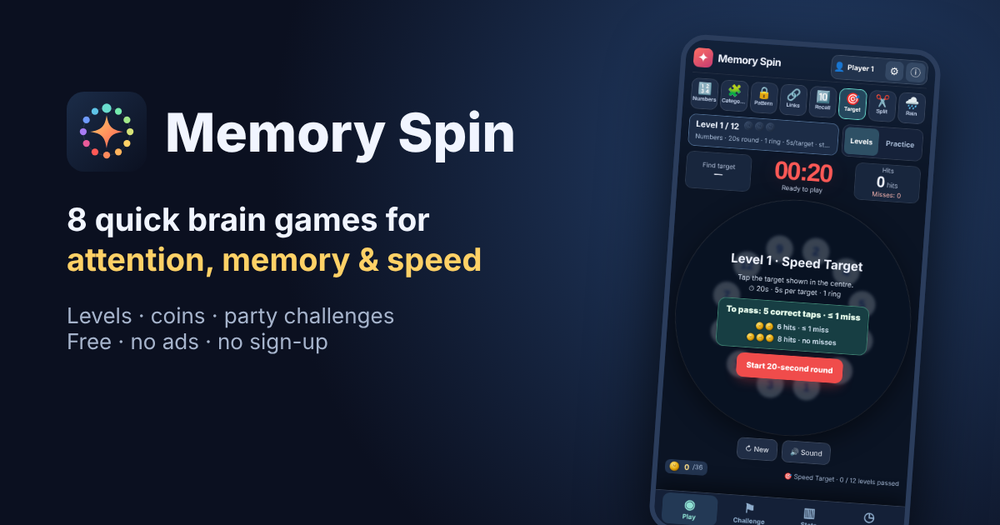

# Memory Spin

**Eight quick brain games for attention, working memory and speed.** Climb a ladder of levels in each game, earn coins for playing well, and challenge friends with a shareable code. Free, no ads, no sign-up.

▶ **Play: https://monaderi1.github.io/memory-spin/**

Version **1.0.1** · released 7 November 2026 · made by Mohammad (Moh) Naderi, Melbourne.

Feedback, bugs or ideas: **memspin@outlook.com** (or ⓘ → Send feedback in the game).

## Play and install

- Open the link on a phone or computer. Nothing to install, and it works offline after the first visit.
- To add it to your home screen: on Android tap **ⓘ → Install app** (or the browser menu → _Install app_); on iPhone tap **Share → Add to Home Screen**.
- Results are stored only in your browser on that device. Use **⚙ → Export backup** to move them to another device.

## Run locally

Open `index.html` in a modern browser. The game itself is a **single HTML file**: no build step or npm install. The other files only add the app icon, the share preview and offline support:

| File                             | Purpose                                                                     |
| -------------------------------- | --------------------------------------------------------------------------- |
| `index.html`                     | The whole game                                                              |
| `manifest.webmanifest`, `icons/` | Installable app (name, icon, colours)                                       |
| `sw.js`                          | Offline play; the page is fetched network-first so updates show immediately |
| `og-image.png`                   | Link preview in WhatsApp, Telegram, social media                            |

When releasing a new version, update `APP_VERSION` and `APP_RELEASED` in `index.html` and the `CACHE` name in `sw.js`.

## Games

- **Numbers**: find 1–50 in order on a mosaic wheel or triple rings, which may be still or spinning. In levels 1–3 found numbers are cleared from the board. Levels 11–16 are **Reverse**: the target shows e.g. 15 and you tap 51 (40 numbers from 12–59, without multiples of 10 or doubles; both 13 and 31 are on the board). They alternate mosaic and triple rings (20/14/6).
- **Categories**: memorize where items sit (numbers, fruits, animals, tools, flags or words), then find each requested one. This replaces the old separate Memory game.
- **Pattern**: repeat a drawn unlock pattern. The 20 levels choose patterns by measured difficulty (turns, crossings, knight moves, jumps over used dots), so high levels never get an easy one by chance. Higher levels also spin faster, in a random direction or chaotically, trace the preview without step numbers, and at the top ask you to draw it backwards.
- **Links**: remember the order in which numbers are connected, then reconnect them after they shuffle.
- **Recall**: reproduce a sequence forward or in reverse (digits, pictures or words).
- **Target**: find changing targets on one or more rings. Levels use numbers and words only (word levels are built from whole look-alike families, so the target shares the ring with near-identical words) (pictures pop out by colour and shape, so they stay in Practice). Numbers sit in small circles; higher levels randomly colour some circles to distract, independent of the target.
- **Split**: memorize a number such as 453278. After it hides, a split rule is revealed: plain pairs (45 32 78), each pair flipped (54 23 87) or pairs from the 2nd digit (53 27). Tap the matching pairs among traps, which include the pairs the other rules would give, reversed pairs and near numbers. Higher levels add digits, mix all rules and require the pairs in order.
- **Rain**: memorize 2–6 numbers (words on levels 4 and 8), then tap only those as they fall. Traps are reversed or near numbers (47 → 74, 48) or words from the same look-alike family (RAIN → RAIL, RAID, REIN, RUIN; 20 families of 5). Letting one of yours fall or tapping anything else costs one of 3 lives. Weather gets harder with level: heavier rain, lightning from level 7, night from level 10 (lightning briefly lights the board). Practice also offers fruits, animals and flags, with traps from the same colour family (🍎 → 🍓 🍒).

## Levels and Practice

Every game has a fixed ladder of levels (9–14 per game). Each level pins all of that game's settings, so results are comparable over time.

- Each level has **one pass condition** (time, mistakes, or correct taps), shown before you start. Pass it and the next level unlocks; otherwise retry.
- After a round you see what was needed and what you did, so you know how close you were.
- **Coins**: a pass earns 🪙; clearly faster and cleaner earns 🪙🪙 or 🪙🪙🪙 (targets shown before the round). Only your best result per level counts, so replaying pays only when you improve.
- **Coin gates**: levels 5, 9, 13 and 17 also need an average of 2 coins across all earlier levels. If you're short, replay earlier levels faster. A level you've passed never re-locks.
- **Practice** keeps the free settings under ⚙ Options. Practice rounds are saved but never count toward levels or stars.

Progress is measured as _highest level passed_. The old 0–1,000 score across mixed settings has been retired. Rounds recorded under the old scoring stay in storage and backups, but they are not charted.

When a ladder's meaning changes, its version (`LADDER_VERSION`) is raised and older rounds for that game are archived. The ladders and pass conditions are defined in `LEVEL_LADDERS` inside `index.html`. They are first estimates and should be tuned after real play-testing.

## Challenges

Build a challenge from any games and levels (up to 8 steps) and get a short code such as `7QX2-P7T5S3` (seed + one letter per game and its level). Anyone who enters the same code gets **exactly the same boards**: while a challenge step runs, the game's random choices come from a generator seeded by the code and step (visual effects use separate randomness).

- One attempt per step; challenge rounds never count toward levels or coins.
- Ranking: steps passed, then total time with +5 s per mistake.
- On one shared phone, each player picks their own profile; the result screen shows that phone's ranking for the code.

## Profiles and results

Profiles and history are stored locally in the browser. Data is not shared between different browser origins, including different local file URLs. Use **Export Backup / Import Backup** under Profiles when moving the file or changing devices.

## Notes

- The user interface is in English.
- Some recorded animal sounds need internet access; the app falls back to synthesized sounds.
- This is an experimental game project, not a clinically validated cognitive assessment or treatment.

## Changelog

### 1.0.1 — 7 November 2026

Send feedback button and contact email in the About screen.

### 1.0.0 — 7 November 2026

First public release: eight games (Numbers, Categories, Pattern, Links, Recall, Target, Split, Rain), per-game level ladders with one pass condition each, coins and coin gates, Practice mode, shareable challenges, About screen and first-visit welcome, installable app with offline play.
